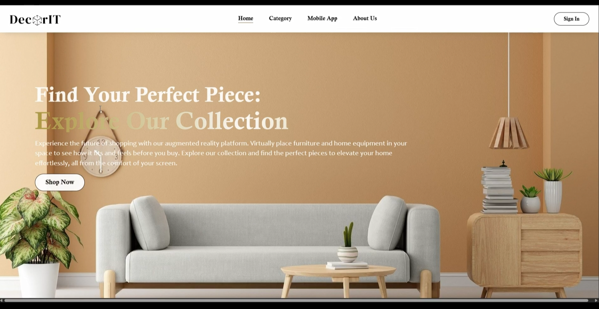
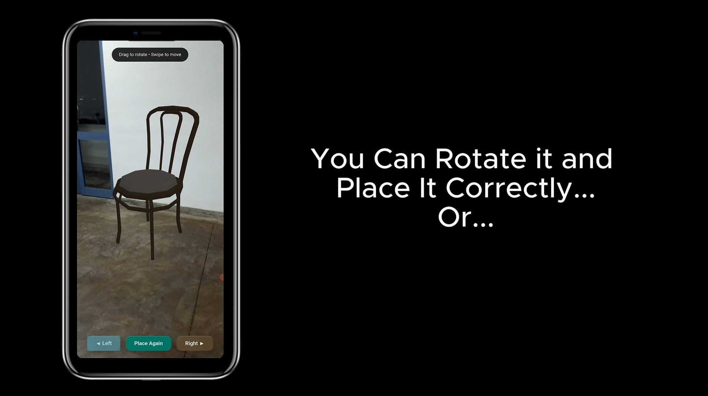
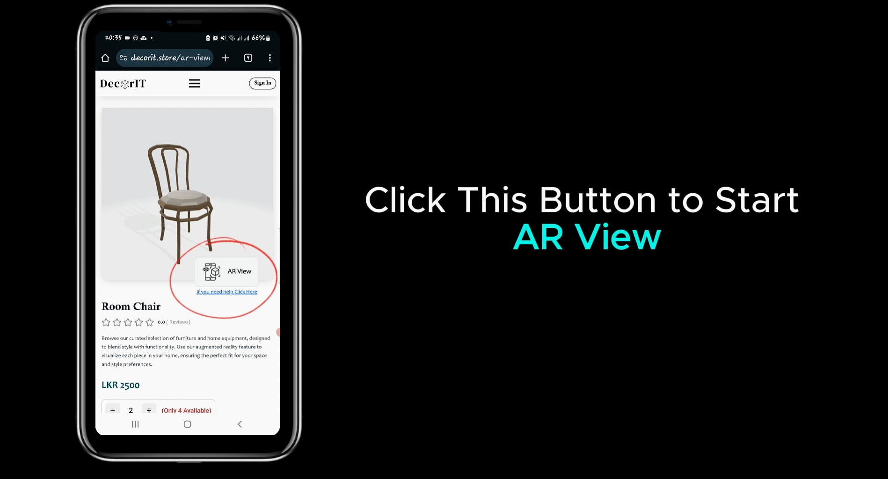

# AR-Based Furniture Application

## 1. Project Title & Short Description
**AR-Based Furniture Application** is a modern e-commerce web application that integrates Augmented Reality (AR) to allow customers to visualize 3D furniture models in their own real-world environment before making a purchase. This enhances the online shopping experience and boosts buyer confidence.

## 2. Project Overview
This project provides a comprehensive e-commerce platform for furniture, built with React and Vite. It not only handles typical online store functionalities like product browsing, cart management, and secure checkout via Stripe, but it also features a built-in AR viewer. By utilizing mobile device cameras and WebXR, users can place 3D models of the furniture in their physical space. The application also includes an admin dashboard for inventory and order management.

## Demo/Screenshots




## 3. Key Features
- **Augmented Reality (AR) Viewer**: View furniture in your space using your mobile device's camera.
- **3D Model Integration**: Includes an embedded 3D viewer for desktop users to inspect items.
- **E-commerce Core**: Complete shopping cart, product categories, and checkout process.
- **User Authentication**: Secure login, registration, password recovery, and email verification.
- **Admin Dashboard**: Comprehensive admin tools for managing products, uploading 3D models (GLTF/GLB), and tracking orders.
- **QR Code Scanning**: Easily jump to the AR viewer on mobile by scanning QR codes displayed on product pages.
- **Payment Processing**: Integrated with Stripe for secure transactions.

## 4. Tech Stack
- **Frontend Framework**: React 18, Vite
- **Styling**: Tailwind CSS, Material UI (MUI), Emotion
- **State Management**: Zustand
- **3D & AR Engine**: Three.js, React Three Fiber, React Three XR, React Three Drei
- **Backend / Database**: Firebase (Authentication, Firestore, Storage)
- **Payment Gateway**: Stripe
- **Routing**: React Router DOM
- **Icons**: FontAwesome, Lucide React, React Icons
- **Testing**: Jest, React Testing Library

## 5. System Architecture
The application follows a client-serverless architecture, where the React frontend directly communicates with Firebase services for authentication, database (Firestore), and media storage (Storage). Stripe handles payment processing, while the 3D models and AR scenes are rendered on the client-side using WebGL and WebXR APIs.

## 6. How It Works / Workflow
1. **Browsing**: Users can navigate through various furniture categories on the web application.
2. **AR Experience**: When users find a piece they like, they can scan a QR code on the screen using their mobile phone.
3. **Placing Furniture**: The mobile phone opens the AR viewer, leveraging the phone's camera to place the 3D model of the furniture in the user's room.
4. **Checkout**: Users can add products to their cart and securely checkout.
5. **Admin Flow**: Administrators log into the dashboard to add new items, track orders, and upload the necessary `.glb` or `.gltf` 3D files for the AR viewer.

## 7. Project Folder Structure
```text
src/
├── assets/          # Static assets like images and logos
├── components/      # Reusable UI components (NavBar, Footer, Item, AR view elements)
├── context/         # React contexts
├── firebase/        # Firebase configuration and custom hooks
├── pages/           # Page components (Home, Cart, Admin Dashboard, ARViewer)
├── User/            # User profile management
├── App.jsx          # Main application routing
└── main.jsx         # Application entry point
```

## 8. Installation & Setup Guide

**Prerequisites:**
- Node.js (v16 or higher recommended)
- npm or yarn

**Steps:**
1. Clone the repository:
   ```bash
   git clone <repository_url>
   ```
2. Navigate into the project directory:
   ```bash
   cd Funiture_site-1
   ```
3. Install dependencies:
   ```bash
   npm install
   ```
4. Start the development server:
   ```bash
   npm run dev
   ```

## 9. Environment Variables
To run this project securely, you should configure Firebase and Stripe credentials via environment variables (`.env` file in the root directory). 
```env
VITE_FIREBASE_API_KEY=your_api_key
VITE_FIREBASE_AUTH_DOMAIN=your_auth_domain
VITE_FIREBASE_PROJECT_ID=your_project_id
VITE_FIREBASE_STORAGE_BUCKET=your_storage_bucket
VITE_FIREBASE_MESSAGING_SENDER_ID=your_messaging_sender_id
VITE_FIREBASE_APP_ID=your_app_id
VITE_STRIPE_PUBLIC_KEY=your_stripe_public_key
```

## 10. Testing Instructions
The project is set up with Jest and React Testing Library.
- Run tests using:
  ```bash
  npm run test
  ```

## 11. Docker / Deployment Instructions
The project is optimized for deployment on **Vercel**, as evident from the `vercel.json` configuration file.
1. Install Vercel CLI (optional) or connect your GitHub repository directly to Vercel.
2. If using CLI:
   ```bash
   npm i -g vercel
   vercel
   ```
3. Follow the prompts to deploy to production.

## 12. Key Engineering Decisions / Challenges
- **AR Implementation**: Integrating WebXR seamlessly across different mobile browsers (iOS Safari and Android Chrome) posed compatibility challenges. Fallbacks were introduced for devices without AR capabilities.
- **3D Model Optimization**: High-quality 3D models can be large in size, impacting load times. The upload process required constraints for file formats (`.glb`/`.gltf`) to maintain performance.
- **QR Code Handoff**: Creating a smooth transition from a desktop browsing experience to a mobile AR experience was solved by dynamically generating QR codes for each product.

## 13. Contributors
- **Lahiru Wanigasooriya** - Developer

## 14. License / Acknowledgements
- **Three.js** and **React Three Fiber** communities for the excellent 3D web ecosystem.
- UI inspiration from modern e-commerce platforms.
